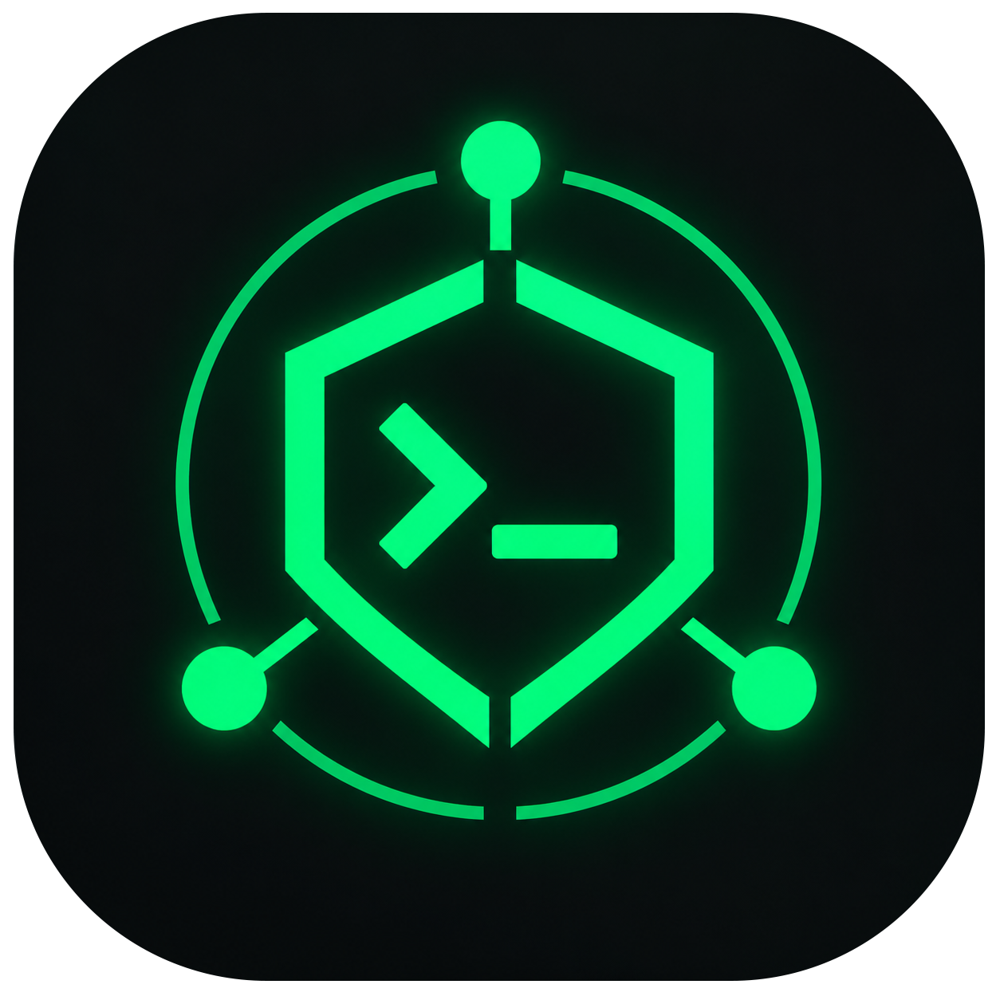

<div align="center">



# HOTLINE DPI

**Bypass ISP throttling & DNS blocking on Windows**

[](https://github.com)
[](https://electronjs.org)
[](LICENSE)
[](https://github.com)

*Unblock Steam · Discord · Reddit · NetEase on Vietnamese ISPs*

</div>

---

## ✦ Overview

Hotline DPI is a desktop app that bypasses ISP-level deep packet inspection (DPI) and DNS blocking — letting you access Steam, Discord, Reddit, and CN games without a VPN.

It combines **GoodbyeDPI** for packet-level bypass with **encrypted DNS** (DoH) via Cloudflare, Google, Quad9, or AdGuard — all wrapped in a clean terminal-style UI.

```
127.0.0.1 → Cloudflare 1.1.1.1 (DoH)  +  GoodbyeDPI bypass
```

---

## ✦ Features

| Feature | Description |
|---|---|
| 🛡 **DPI Bypass** | GoodbyeDPI — defeats ISP packet inspection |
| 🔒 **Encrypted DNS** | DNS-over-HTTPS via Cloudflare / Google / Quad9 / AdGuard |
| ⚡ **Low overhead** | ~1–2% CPU, no VPN tunnel, full download speed |
| 🎮 **Game support** | Steam, Discord, Reddit, NetEase CN games |
| 🔄 **Auto-restore** | Original DNS restored automatically on disconnect |
| 📊 **Live stats** | Latency, queries/min, active services |
| 🖥 **System tray** | Runs in background, one-click connect/disconnect |

---

## ✦ Requirements

- Windows 10 / 11 (x64)
- Node.js 18+
- **Administrator privileges** (required for DNS changes & GoodbyeDPI)

---

## ✦ Quick Start

**1. Install dependencies**

```powershell
# Run PowerShell as Administrator
cd "D:\Unlock Steam\HotlineDPI"
Set-ExecutionPolicy -Scope Process Bypass
.\setup.ps1
```

> `setup.ps1` downloads GoodbyeDPI and dnsproxy into `bin\` automatically.

**2. Launch**

```powershell
# Option A — double-click (auto-elevates to admin)
start.bat

# Option B — PowerShell as Administrator
npm start
```

---

## ✦ DPI Modes

| Mode | Description | CPU impact |
|---|---|---|
| **Light** | TCP fragment only | ~0% |
| **Balanced** *(default)* | Fake packet + fragment | ~1–2% |
| **Strong** | All GoodbyeDPI techniques | ~3–5% |

Start with **Balanced** — works on most Vietnamese ISPs. Switch to **Strong** only if needed.

---

## ✦ DNS Servers

| Server | Address | DoH |
|---|---|---|
| Cloudflare | 1.1.1.1 | ✓ |
| Google | 8.8.8.8 | ✓ |
| Quad9 | 9.9.9.9 | — |
| AdGuard | 94.140.14.14 | — |

---

## ✦ Project Structure

```
HotlineDPI/
├── assets/             ← Icons
├── bin/
│   ├── goodbyedpi/     ← GoodbyeDPI engine
│   └── dnsproxy/       ← AdGuard dnsproxy (DoH)
├── src/
│   ├── main.js         ← Electron main process + tray
│   ├── preload.js      ← IPC bridge
│   ├── backend.js      ← Node.js backend logic
│   └── renderer/
│       ├── index.html  ← UI layout
│       ├── app.js      ← UI logic
│       └── style.css   ← Styling
├── setup.ps1           ← Dependency installer
└── start.bat           ← Launcher (auto admin)
```

---

## ✦ Notes

- GoodbyeDPI may be flagged by antivirus — add `bin\goodbyedpi\` to your AV whitelist
- Your original DNS is saved and restored automatically on disconnect
- The app hides to system tray on close — right-click the tray icon to quit

---

## ✦ Third-party

| Tool | License |
|---|---|
| [GoodbyeDPI](https://github.com/ValdikSS/GoodbyeDPI) | Apache 2.0 |
| [dnsproxy](https://github.com/AdguardTeam/dnsproxy) | Apache 2.0 |
| [Electron](https://electronjs.org) | MIT |

---

<div align="center">

Made with ♥ by **Sú**

</div>
